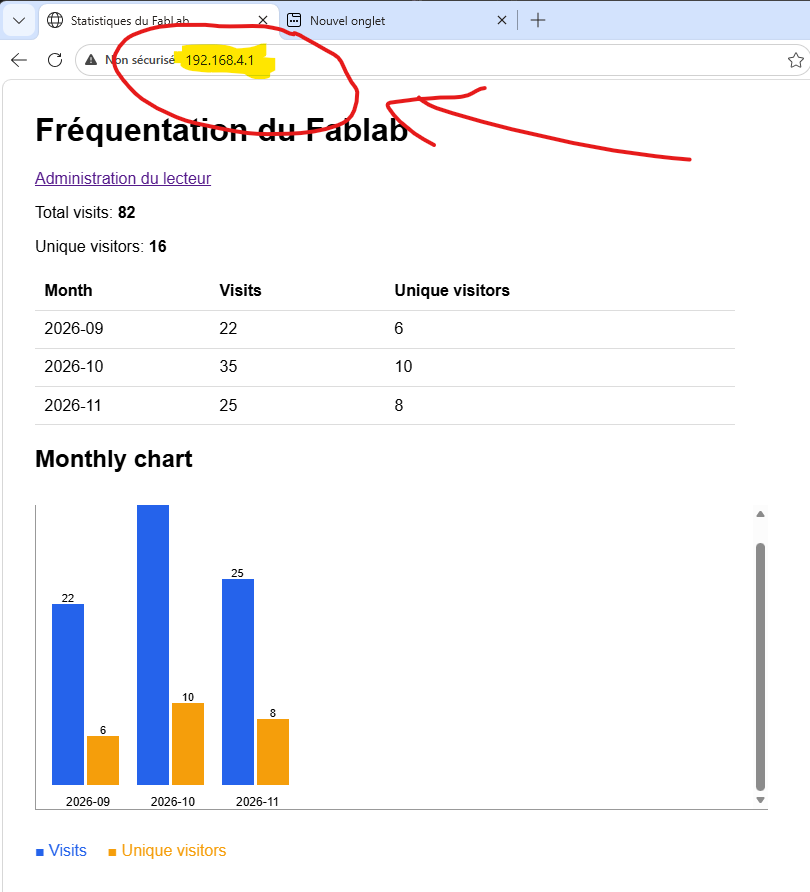
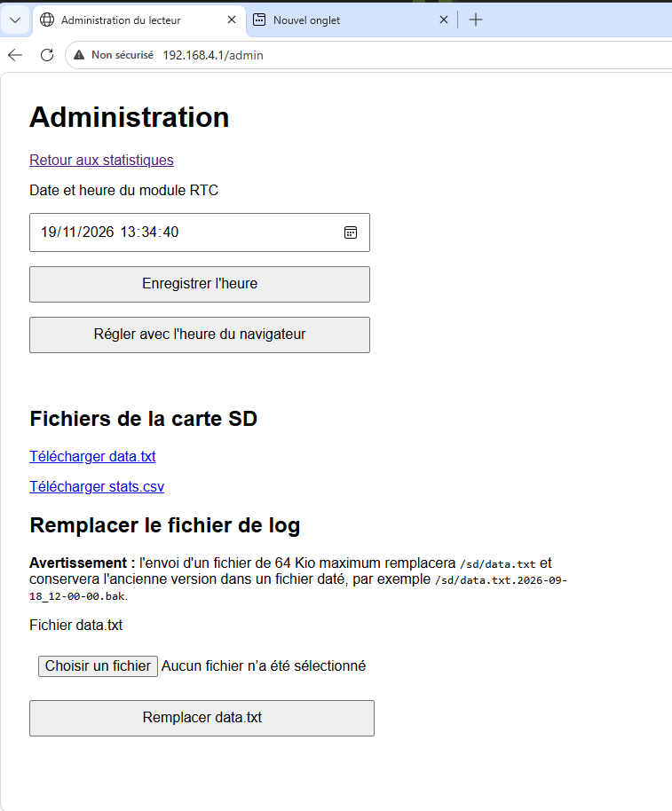

# Manuel utilisateur du lecteur de badge

## Mise en service et utilisation
- Fixer le lecteur de badge à l'aide de la bande velcro
- Brancher l'allimentation électrique (6 à 12V)
- L'appareil émet un "bip-bip" et est prêt à fonctionner. Il affiche l'heure (son horloge à lui), ainsi que le nombre total de visiteurs enregistrés.
- Vérifier que l'heure de l'appareil est correcte. Le cas échéant, régler l'heure avec la page d'administration (voir plus loin)
- Au badgeage, un musique aléatoire (parmi 4 pour l’instant) est jouée, et le nombre total de badgeages est incrémenté.  
- Il y a un « anti-passback », qui inhibe le badgeage pendant 1h pour chaque badge.  
- seuls les badges Thales (visiteurs compris) fonctionnent. Les pass Navigo par exemple ne sont pas comptabilisés. 
- L'appareil n'a accès à aucune information nominative. Il enregistre uniquement l'identifiant du badge.

## Restitution des données
- Appuyer sur le bouton latéral jusqu'à ce que l'affichage de l'écran change (affichage d'un identifiant de hotspot, un mot de passe et une adresse ip). Le serveur web est stoppé au bout de 10 minutes ou après un nouvel appui sur le bouton.
- Avec un téléphone ou un ordinateur non Thales (ordinateurs du fablab par exemple), connectez-vous en wifi sur le hotspot indiqué.
- Saisissez, dans la barre d'adresse d'un navigateur, l'adresse IP indiquée sur l'écran (192.168.4.1).
- La page suivante devrait être affichée:  

## Administration

Un lien vers une page d'administration est disponible depuis la page de stats.
Elle permet :
- De régler l'heure. Le plus simple est de cliquer sur "Regler avec l'heure du navigateur"
- De télécharger les données brutes (log de badgeage data.txt)
- De télécharger les données exploitées par mois et qui distinguent les visiteurs uniques (stats.csv)
- D'écraser le fichier de log (attention, effacement des données), afin par exemple de [permuter l'utilisation](permutation_usage.md) de l'appareil pour un évènement particulier.   

# Ajout d'une nouvelle musique
1. décrire la partition sous forme d'une succession de notes. Chaque note est un couple (hauteur, durée). La hauteur de la note s'écrit suivant la notation anglo-saxone (voir documentation dans le fichier `songs.py` )
2. Rajouter cette liste de couples sous forme d'une variable liste python dans le fichier `songs.py` (voir exemples existants)
3. Rajouter cette variable à la liste des musiques `songs`, en précisant un tempo
4. En utilisant vscode, uploader le fichier songs.py sur le pico, à l'aide d'un cordon USB-microUSB
